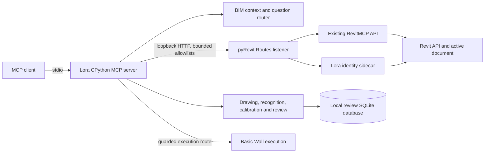

# Lora and RevitMCP Architecture

## Components

The MCP server is a standard CPython application; it is not loaded into pyRevit. The Revit-side identity provider is a separate pyRevit extension that registers diagnostic routes with the Routes service. Lora queries existing RevitMCP routes for project/model data and uses explicit identity checks around guarded operations.

## Route and identity behavior

The client uses explicit route/method allowlists, IPv4 loopback, bounded connection/read timeouts and response sizes, and disables proxy/netrc environment handling for Revit requests. It discovers a unique endpoint and pins it; ambiguity or a failed pinned endpoint does not silently switch to another Revit process. Guarded requests compare identity before and after the operation.

The identity API may not supply a stable document GUID or all application metadata. In that case the client keeps identity uncertainty explicit and rejects operations requiring certainty. A document title or path alone is not treated as stable identity.

## Read and write boundaries

Project context, category/geometry inspection and drawing analysis are evidence/reporting workflows. Geometry inspection is bounded and does not calculate physical clearance. Drawing processing accepts inbox filenames and does not call Revit. Review and planning records persist locally.

The principal MCP server also exposes controlled Basic Wall execution. The execution path is separate from read-only tools and requires prepared-plan validation, explicit human approval, identity checks and transaction/result handling. The broader ribbon includes other writing commands. Do not describe the complete Lora system as read-only.

## Security boundary

The Revit Routes listener is shared by co-loaded extensions and is not a process-isolation boundary. The identity sidecar checks for loopback registration and fails closed when the reported/configured host is not the required loopback address. This does not authenticate another process running on the same computer. Routes transport is HTTP, and its handler interface does not expose authenticated caller metadata. A separate service/process boundary or OS-protected IPC would be needed for stronger isolation.

Confirm listener binding, process ownership and extension revision before a controlled deployment. This document describes source behavior; it does not assert current host configuration. See [Security.md](Security.md), [RevitConnection.md](RevitConnection.md) and [RevitIdentityDeployment.md](RevitIdentityDeployment.md).
